# Habla Fluido

> Aprende inglés con un tutor de IA: pronunciación, oído, lectura, escritura y conversación.

[Flutter 3.47] · [Dart 3.13] · [Node.js] · [IA generativa vía proxy] · [TDD]

---

## 📖 Descripción

**Habla Fluido** es una app móvil que ayuda a estudiantes de inglés a ganar confianza hablando. No sustituye al docente ni a la conversación con personas reales: multiplica las horas de práctica con retroalimentación inmediata, frases completas y repetición espaciada.

El proyecto se construyó siguiendo el manual *Paso a paso con TDD* de la asignatura Desarrollo Móvil Integral (UTNG).

**Ruta del proyecto:** `C:\Users\sofi7\habla_fluido`

---

## ✨ Características

- Plan diario de 20 minutos que reparte tiempo entre cinco habilidades.
- Más tiempo para la habilidad más débil.
- Dictado y pronunciación con comparación palabra por palabra.
- Retroalimentación con colores y texto: correcta, parecida, sustituida, omitida y sobrante.
- Repetición espaciada con SM-2 y recuperación activa.
- Tutor conversacional que corrige máximo 2 errores por turno y siempre pregunta algo.
- Tutor simulado por defecto: funciona sin internet ni costo.
- Tutor real opcional mediante un proxy Node que guarda la llave y el prompt en el servidor.
- Progreso guardado localmente con `shared_preferences`.

---

## 📱 Capturas de la app

### Inicio

Muestra nivel, racha, plan del día y repasos pendientes.

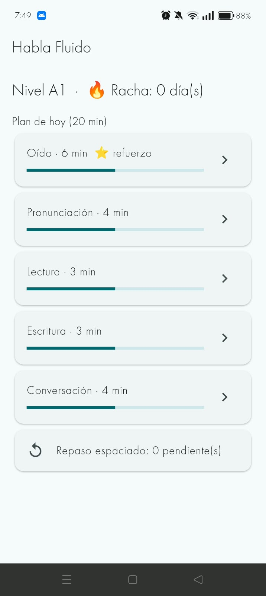

### Pronunciación (shadowing)

Escuchas el modelo, lo repites y la app compara lo que reconoció.

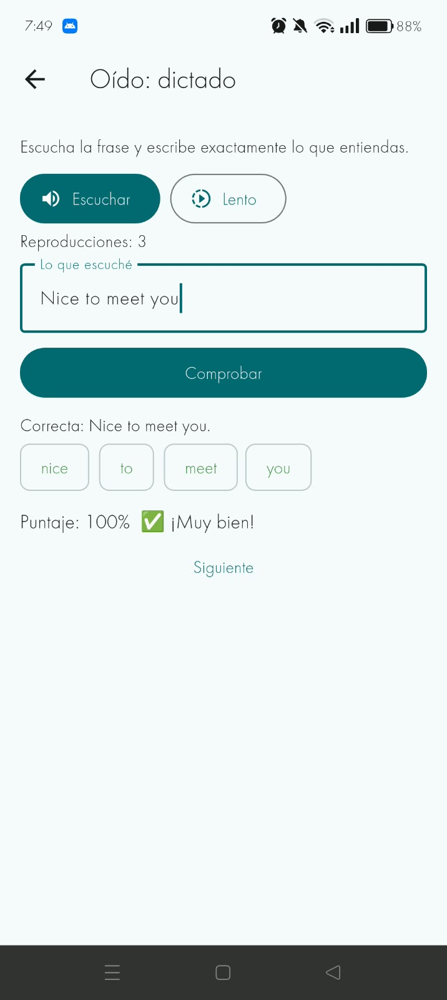

### Oído: dictado

Escuchas, escribes y comparas palabra por palabra.

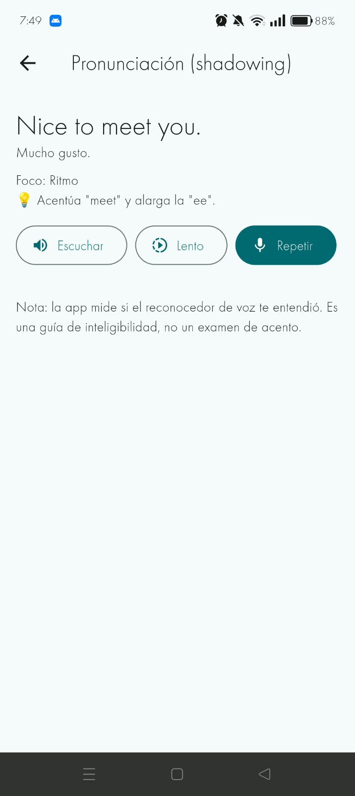

### Conversación con el tutor

El tutor responde al contenido, corrige poco y termina con una pregunta.

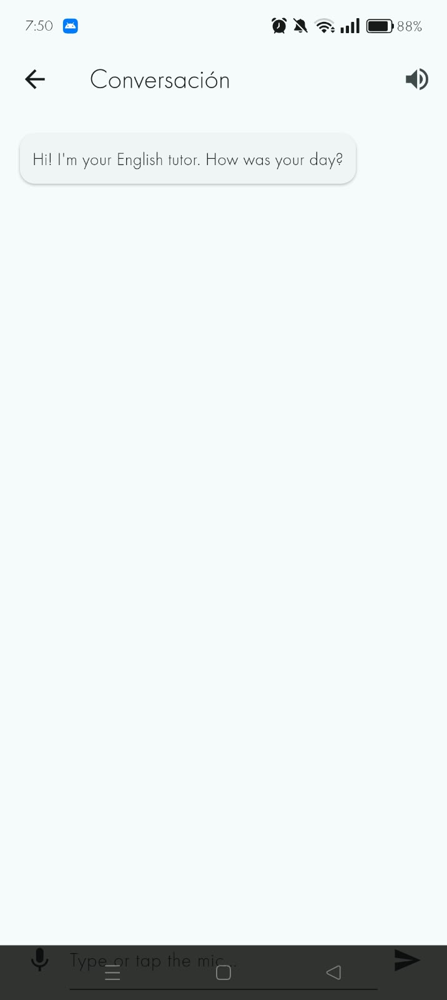

### Repaso espaciado

Dices la frase en inglés antes de ver la respuesta y te autocalificas.


---

# Pruebas TDD 

## Ronda 2 — Comparador

Archivo: `test/comparador_test.dart`

🔴 Rojo:

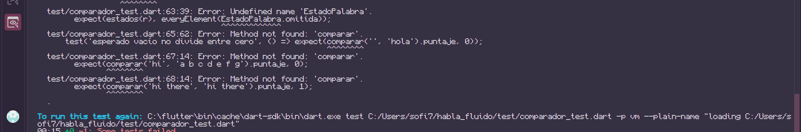

🟢 Verde:

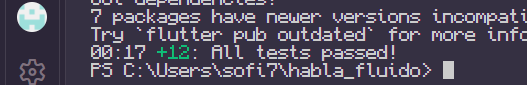

## Ronda 3 — Repetición espaciada SM-2

Archivo: `test/repaso_progreso_test.dart`

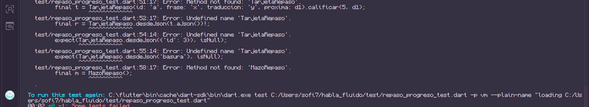
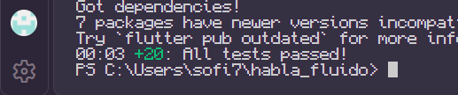

## Ronda 4 — Progreso y plan diario

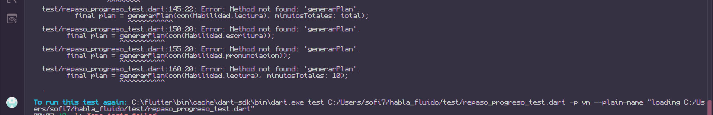
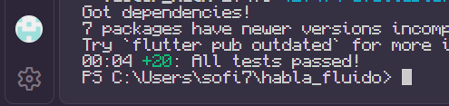

## Ronda 6 — Proxy

Comando: `node --test proxy/test/proxy.test.js`

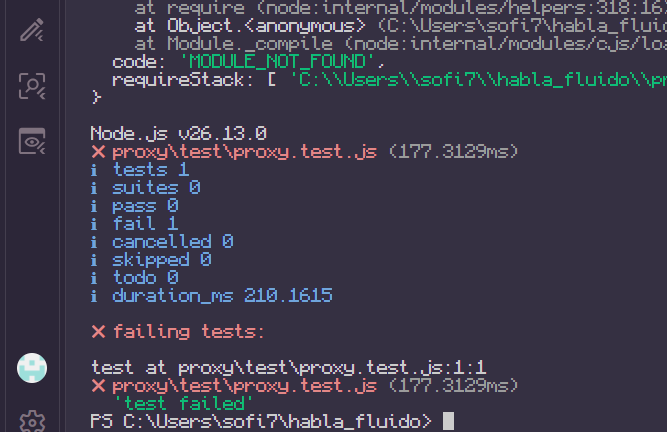
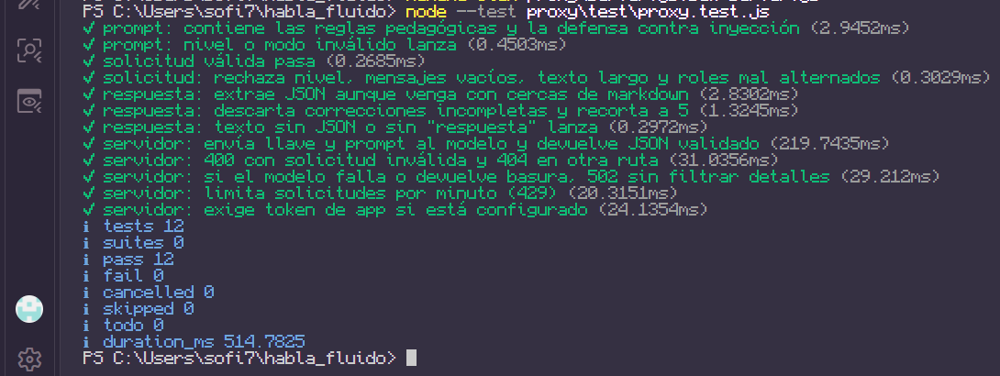

## Ronda 7 — Tutor

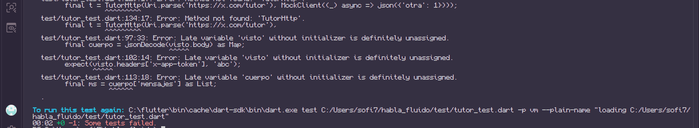
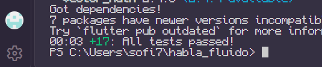

## Ronda 9 — ViewModels

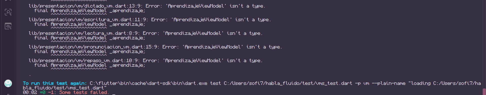
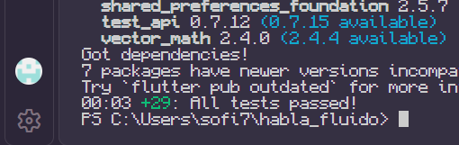

## Ronda 10 — Pantallas y build

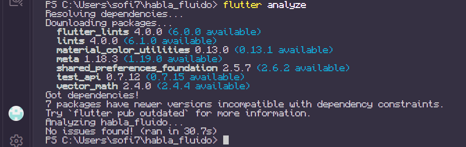
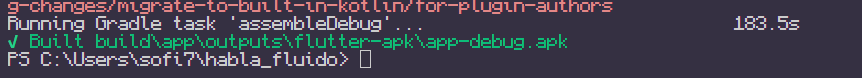

## Resultado final

```powershell
flutter test
node --test proxy/test/proxy.test.js
flutter analyze
